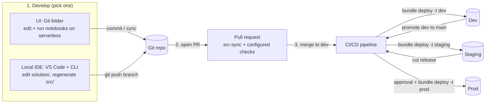
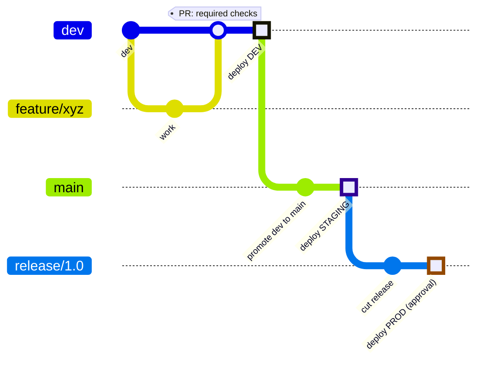

# Databricks MLOps Workshop

Materials and hands-on labs for a 1-day Databricks MLOps workshop: feature engineering, MLflow experiment tracking, model registry and governance, batch inference, serving, and productionisation with Workflows and **Declarative Automation Bundles** (formerly Databricks Asset Bundles / DABs).

## The Dataset

The [Financial Transactions Fraud Dataset](https://www.kaggle.com/datasets/computingvictor/transactions-fraud-datasets) is public, synthetic consumer card activity with no real customer data. Five files form the fraud-detection dataset:

| Source | Grain | Key columns |
|---|---|---|
| `transactions_data.csv` | one row per card transaction (~13M rows, spanning **2009-2019**) | `id`, `client_id`, `card_id`, `amount`, `date`, `mcc`, `use_chip`, `merchant_state` |
| `cards_data.csv` | one row per card | `id`, `client_id`, `card_brand`, `card_type`, `credit_limit`, `num_cards_issued` |
| `users_data.csv` | one row per client | `id`, `current_age`, `yearly_income`, `total_debt`, `credit_score`, `num_credit_cards` |
| `mcc_codes.json` | Merchant Category Code lookup | `mcc` → description |
| `train_fraud_labels.json` | fraud label per transaction | `transaction_id` → `is_fraud` |

Ingestion follows a **medallion architecture** (landing → bronze → silver → gold), producing the denormalised, labelled `transactions_enriched` gold table (37 columns). The target, `is_fraud`, is **highly imbalanced**: fraud is a fraction of a percent of transactions, making evaluation, thresholding, and monitoring important.

The dataset is **not included**; see [Load the data](#load-the-data).

## Environment Setup

Instructors provision and seed the shared data once; attendees use the [`personal` target](#data-isolation-shared-reads-personal-writes). The dev workspace uses the `dev` Unity Catalog catalog, with schemas and a landing volume declared in [databricks.yml](databricks.yml).

### Prerequisites

- **Databricks CLI** installed (`databricks version`).
- Workspace authentication: **Azure CLI auth** (`az login` against the correct tenant) or a CLI profile.

### Optional: AI coding assistant skills

Install the official [Databricks agent skills](https://learn.microsoft.com/en-us/azure/databricks/agent-skills/) for supported coding assistants, including GitHub Copilot:

```powershell
databricks aitools install --scope global
```

The installer detects assistants and adds guidance for bundles, jobs, training, and serving globally, outside this repository. No third-party skills are bundled here.

### Run it

**Create the `dev` catalog first** in Catalog Explorer (**Catalog → Create catalog**); the bundle does not create catalogs. Then, from the repo root:

```powershell
databricks bundle deploy -t dev
```

The clean `dev`, `staging`, and `prod` targets provision shared schemas and the `raw_data` volume via the `shared_infra` anchor. The default `personal` target uses those shared inputs but creates only attendee-specific resources.

### What it creates (under the `dev` catalog)

| Object | Type | Purpose |
|---|---|---|
| `dev.fraud_landing` | schema | Landing zone for raw source files stored in volumes |
| `dev.fraud_bronze` | schema | Bronze layer: raw ingested fraud data |
| `dev.fraud_silver` | schema | Silver layer: cleaned, typed, joined data |
| `dev.fraud_gold` | schema | Gold layer: shared curated **source** (`transactions_enriched`) read by all users |
| `dev.fraud_landing.raw_data` | managed volume | Landing zone for raw source files (CSV/JSON), one folder per dataset |
| `dev.fraud_ml` | schema | Shared ML outputs on the clean `dev` target |

Feature tables, registered models, predictions, and monitoring metrics go to `fraud_ml` on clean targets or `dev_<you>_fraud` on `personal`. MLflow experiments are workspace objects (`/Users/...`), not Unity Catalog schemas.

### Load the data

1. **Download** the [dataset](https://www.kaggle.com/datasets/computingvictor/transactions-fraud-datasets) from Kaggle (sign in and accept the terms). Get all five files listed above, via the website or Kaggle CLI:

   ```powershell
   kaggle datasets download -d computingvictor/transactions-fraud-datasets -p .tmp/kaggle --unzip
   ```

2. **Upload** each file to its own folder in `dev.fraud_landing.raw_data`, via Catalog Explorer or the CLI:

   ```powershell
   databricks fs cp .tmp/kaggle/transactions_data.csv   dbfs:/Volumes/dev/fraud_landing/raw_data/transactions/
   databricks fs cp .tmp/kaggle/cards_data.csv          dbfs:/Volumes/dev/fraud_landing/raw_data/cards/
   databricks fs cp .tmp/kaggle/users_data.csv          dbfs:/Volumes/dev/fraud_landing/raw_data/users/
   databricks fs cp .tmp/kaggle/mcc_codes.json          dbfs:/Volumes/dev/fraud_landing/raw_data/mcc_codes/
   databricks fs cp .tmp/kaggle/train_fraud_labels.json dbfs:/Volumes/dev/fraud_landing/raw_data/fraud_labels/
   ```

3. **Run ingestion** to build bronze → silver → gold:

   ```powershell
   databricks bundle run data_ingestion_job -t dev
   ```

The [instructor-only ingestion job](resources/data-ingestion-workflow.yml) loads CSV/JSON with schemas and audit columns, then cleans, types, deduplicates, and joins the data. Its [notebooks](solution/data_ingestion/) accept catalog/schema/volume overrides through `dbutils.widgets`. Attendees use the resulting silver/gold tables, not the raw files.

## The ML Use Case: Fraud Detection

Every lab uses the same **binary classification** problem: predict `is_fraud` (true/false, from `train_fraud_labels`) for each `transaction_id`, using the joined transaction, card, client, and merchant-category attributes in gold `transactions_enriched`.

### Features (real-time split)

To score a brand-new transaction, serving combines entity lookups with on-demand Unity Catalog feature functions. Training uses the same definitions to avoid train/serve skew.

| Features | Lookup / computation | Values |
|---|---|---|
| Card | `card_features`, keyed by `card_id` | `credit_limit`, `num_cards_issued` |
| Client | `client_features`, keyed by `client_id` | `credit_score`, `yearly_income`, `current_age` |
| On-demand | UC functions applied to the request | `is_night`, `is_online`, `is_high_risk_mcc`, `amount_to_income_ratio`, `amount_to_credit_limit_ratio` |

### Proposed models (progression)

Two simple Random Forest runs keep the focus on MLOps rather than hyper-tuning:

| Stage | Model | Why |
|---|---|---|
| Baseline | **Random Forest** (raw imbalanced data) | Establishes the imbalance problem: ~99.8% accuracy but recall &asymp; 0 (flags no fraud) |
| Balanced (registered) | **Random Forest** (balanced training data) | Keeps every fraud row and down-samples non-fraud to 1:1, rather than using class weights; this version is registered and promoted |

Evaluation uses the **untouched, imbalanced test set**. The notebook explores the resulting precision/recall trade-off and why the decision threshold is a business choice.

### Evaluation metrics

The promotion gate uses **ROC-AUC**. MLflow also tracks precision, recall, macro F1, and accuracy for context; a confusion matrix supports the champion/challenger and threshold discussion. Accuracy alone is misleading on this dataset.

> **Allow 15-25 minutes for first-time serving.** Registering a model version automatically triggers `deployment_job`, which provisions a Lakebase online feature store, publishes `card_features` and `client_features`, and creates the endpoint. Wait for it to finish before running [`query_endpoint.py`](src/deployment/model_deployment/notebooks/query_endpoint.py); querying also seeds traffic for the online monitor.

## Developer workflow

Develop in the Databricks UI or a local IDE, commit to Git, and promote through CI/CD. **Never edit prod directly.**

This flow assumes [CI/CD is enabled](#cicd-promoting-the-bundle-across-environments); automatic deployments are disabled in the public repo.



### 1. Develop: two ways to edit

**a) In the Databricks UI (Git folder, no local install)**

1. In the workspace: **Workspace → Create → Git folder**, paste this repo's URL, **Clone**.
2. Databricks recognises the root `databricks.yml` and opens the bundle editor. Select **personal → Deploy** before running notebooks or jobs.
3. Fill in a lab under `src/` or consult `solution/`, then run on **serverless compute** (must be enabled), or **Run** a job from the bundle editor. No YAML or CLI needed.

**b) In a local IDE (VS Code + Databricks CLI)**

1. `git clone` the repo locally.
2. For repository changes, edit `solution/` and regenerate `src/`, then deploy and run in your own namespace:

   ```powershell
   python scripts/generate_src.py
   databricks bundle deploy -t personal
   databricks bundle run <job> -t personal
   ```

In both cases, `personal` uses development mode: resources are username-prefixed and schedules are paused.

### 2. Commit

Use a **short-lived feature branch**. Commit/sync through the Git folder or commit and push locally, including regenerated `src/`, notebooks, and bundle YAML. Git is the source of truth.

### 3. CI/CD promotes the bundle (dev → staging → prod)

Open a PR into `dev`, then promote through `main` (staging) and a release (prod). Cross-workspace promotion uses CI/CD, not the local workspace's bundle editor. See the [setup and current workflow limitations](#cicd-promoting-the-bundle-across-environments) below.

## CI/CD: promoting the bundle across environments

Promote **code, not models**: deploy the same reviewed bundle to `dev`, `staging`, and `prod`, each with its own catalog and data. Training runs separately in each environment.

**Public repo defaults:** automatic deployments are intentionally disabled so a push or tag cannot deploy real resources. [CD](.github/workflows/cd.yml) supports manual dispatch; enable its push/tag triggers when adopting this workflow in a real environment. [CI](.github/workflows/ci.yml) currently checks generated `src/` on PRs and pushes to `main`; linting is disabled and PR bundle validation is not configured. The production setup below includes those checks and deployment gates.

### Branching model (multi-env with a release branch)



| Stage | Intended trigger | Target | Gate |
|---|---|---|---|
| CI | PR to `dev` / `main` | Validate only | src-sync, lint, and bundle validation |
| Dev integration | Push/merge to `dev` | `-t dev` | Automatic after PR checks |
| Staging | Promote `dev` → `main` | `-t staging` | Automatic after PR checks |
| Prod | Cut `release/**` from `main` or tag `vX.Y.Z` | `-t prod` | Required GitHub Environment reviewer |

Each deploy authenticates as an environment-specific service principal. `dev` is a clean, shared integration target; attendees use `personal`, which can coexist in the same workspace without overwriting shared outputs.

Run the pipeline end-to-end in dev and against staging data before releasing. CD currently validates and deploys the bundle; running jobs or smoke tests is a separate step (see the optional training smoke test in the workflow).

### Wiring it up (what a real setup needs)

1. **Service principals:** create one per environment with workspace deploy/run permissions. Staging/prod use production mode and fixed `root_path` values for a single deployment; see [databricks.yml](databricks.yml).
2. **OIDC federation:** give each principal a GitHub Actions federation policy matching the repo and GitHub Environment, e.g. `repo:<org>/<repo>:environment:production`. Tokens are short-lived; no long-lived authentication secret is needed.
3. **GitHub Environments:** create `dev`, `staging`, and `production` under **Settings → Environments**. Set `DATABRICKS_HOST` as an environment variable and `DATABRICKS_CLIENT_ID` (the principal's application ID) as an environment secret. CD sets `DATABRICKS_AUTH_TYPE: github-oidc` and `id-token: write`; add a **required reviewer** to `production`.
4. **Checks and triggers:** configure lint and PR bundle validation alongside src-sync, require checks and a review for merges to `dev`/`main`, then enable CD's commented `push` block, including `dev`, `main`, `release/**`, and `v*.*.*` tags.

The bundle provisions shared medallion resources on all clean targets. Separately from GitHub's deploy approval, the model deployment job uses `auto_approve: "true"` on dev and requires human UC-tag approval on staging/prod (`"false"`).

## Data isolation: shared reads, personal writes

Attendees read instructor-seeded `dev.fraud_landing` / `fraud_bronze` / `fraud_silver` and `dev.fraud_gold.transactions_enriched`, and write features, models, predictions, and metrics to `dev.dev_<you>_fraud`.

[Medallion layers](https://docs.databricks.com/aws/en/lakehouse/medallion) organise shared data by quality; [personal schemas](https://docs.databricks.com/aws/en/developers/best-practices) prevent developers overwriting each other's outputs. They serve different purposes: there is no need to duplicate bronze/silver/gold per attendee.

### How the per-user schema works

The [`fraud_ml` schema resource](resources/schemas-resource.yml) keeps that name on clean dev/staging/prod targets. `personal` overrides its base name to `fraud`; development mode adds `[dev <your-short-name>]` (sanitised for schemas), producing `dev_<you>_fraud`.

Jobs pass the resource's **resolved name** to notebooks:

```yaml
base_parameters:
  gold_schema: ${var.gold_schema}                      # shared read    -> fraud_gold
  ml_schema: ${resources.schemas.fraud_ml.name}        # personal write -> dev_<you>_fraud
```

Notebooks build the three-level `uc_model_name` from the catalog, resolved `ml_schema`, and bare `model_name` (default `fraud_detection`): `${var.catalog_name}.${resources.schemas.fraud_ml.name}.${var.model_name}`.

**Reference the resource, not a hand-written schema variable:** development mode prefixes resources, not arbitrary variable values. `${resources.schemas.fraud_ml.name}` keeps notebook writes aligned with the schema actually created.

### Attendee flow

Clone as a Git folder, deploy **personal** to create your schema and `[dev <you>]` jobs, then run the labs. **Deploy before running notebooks**: notebooks do not create schemas, and shared data must already have been provisioned by the instructor.

## Repository Structure

The repo follows the Databricks `mlops-stacks` layout: notebook entrypoints live in `<stage>/notebooks/` as standard `# Databricks notebook source` files, with importable helpers alongside them.

```
databricks-mlops-workshop/
  databricks.yml                     ← bundle variables, resources, and targets
  resources/                        ← YAML: schemas, volume, jobs, model, experiment, monitors
  solution/                         ← complete notebooks, source of truth
    exploration/notebooks/          ← optional read-only EDA
    data_ingestion/notebooks/       ← instructor-only landing → bronze → silver → gold
    feature_engineering/notebooks/
    training/notebooks/
    deployment/batch_inference/notebooks/
    deployment/model_deployment/notebooks/
    monitoring/notebooks/
  src/                              ← generated attendee notebooks with TODO gaps
  scripts/generate_src.py            ← regenerates src/ from solution/
  .github/workflows/                 ← CI/CD
```

See [`resources/`](resources/README.md) for bundle resources and [`scripts/`](scripts/README.md) for the generator.

## Hands-on labs

Start with the optional [`eda.py`](src/exploration/notebooks/eda.py): explore gold data, class imbalance, and fraud by amount, hour, and merchant category. It has no TODO gaps and runs interactively, not as a job.

Labs use the gapped `src/` notebooks; complete references are in `solution/`.

| # | Lab / agenda session | What you do |
|---|---|---|
| 1 | [Feature engineering](src/feature_engineering/) / Model Development & Experimentation | Build governed, reusable card/client feature tables and on-demand UC functions. |
| 2 | [Experiment tracking & training](src/training/) / Model Development & Experimentation | Assemble data with `FeatureLookup`, compare baseline and balanced runs in MLflow, and register the champion with a signature and input example. |
| 3 | [Registry & governance](src/training/) / Model Management & Governance | Manage UC model versions, tags, descriptions, aliases, lineage, and access control. |
| 4 | [Model promotion](src/deployment/model_deployment/) / Model Promotion Lifecycle | Apply the ROC-AUC gate and `@champion` / `@challenger` aliases, keeping deployment separate from inference code. |
| 5 | [Batch inference](src/deployment/batch_inference/) / Model Serving & Consumption | Load by alias, score with automatic feature lookup, and persist predictions with model versions. |
| 6 | [Model serving](src/deployment/model_deployment/) / Model Serving & Consumption | Publish online features, deploy the champion to Mosaic AI serving, and query a new transaction. |
| 7 | [Inference monitoring](src/monitoring/) / Monitoring & Retraining | Use Lakehouse Monitoring on batch and live traffic to track quality (including precision/recall), prediction drift, and feature drift. |
| 8 | [Retraining](src/monitoring/) + [training](src/training/) / Monitoring & Retraining | Trigger retraining on degraded label-based quality or sustained feature drift; promote without changing inference code. |

## Files and Folders

### `solution/` and `src/`

**For contributions, edit `solution/`, not generated `src/`.** `python scripts/generate_src.py` removes solution blocks marked `# TODO-BEGIN … # TODO-END` to create the attendee TODO gaps. The `personal` target deploys `src/`; clean dev/staging/prod targets deploy runnable `solution/` notebooks.

The instructor-only [`load_landing_to_bronze.py`](solution/data_ingestion/notebooks/load_landing_to_bronze.py) and [`load_bronze_to_silver.py`](solution/data_ingestion/notebooks/load_bronze_to_silver.py) have no TODO gaps and are copied verbatim. See [Load the data](#load-the-data) for their setup and use.

## Contributing

Contributions and suggestions are welcome; see [CONTRIBUTING.md](CONTRIBUTING.md). Most contributions require a [Contributor License Agreement (CLA)](https://cla.opensource.microsoft.com). This project follows the [Microsoft Open Source Code of Conduct](CODE_OF_CONDUCT.md). See [SECURITY.md](SECURITY.md) to report security issues and [SUPPORT.md](SUPPORT.md) for help.

## License

Released under the [MIT License](LICENSE).

## Trademarks

This project may contain trademarks or logos for projects, products, or services. Authorized use of Microsoft trademarks or logos is subject to and must follow [Microsoft's Trademark & Brand Guidelines](https://www.microsoft.com/en-us/legal/intellectualproperty/trademarks/usage/general). Use of Microsoft trademarks or logos in modified versions of this project must not cause confusion or imply Microsoft sponsorship. Any use of third-party trademarks or logos is subject to those third-parties' policies.
